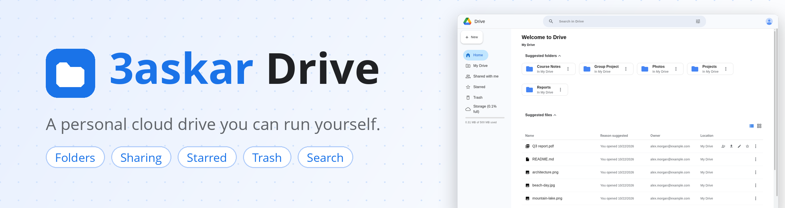
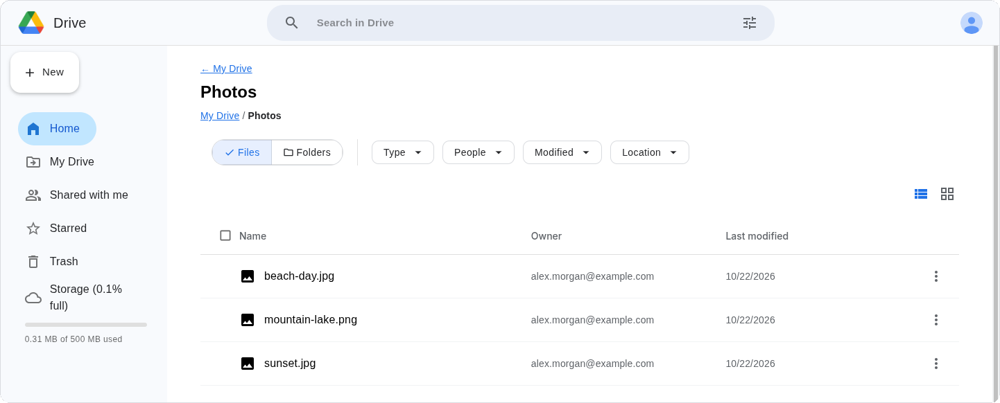
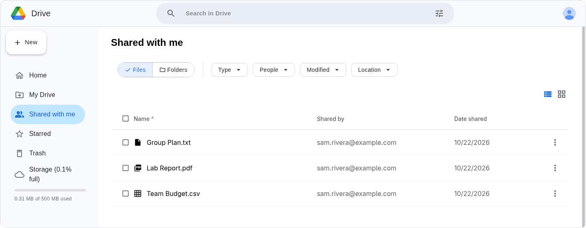
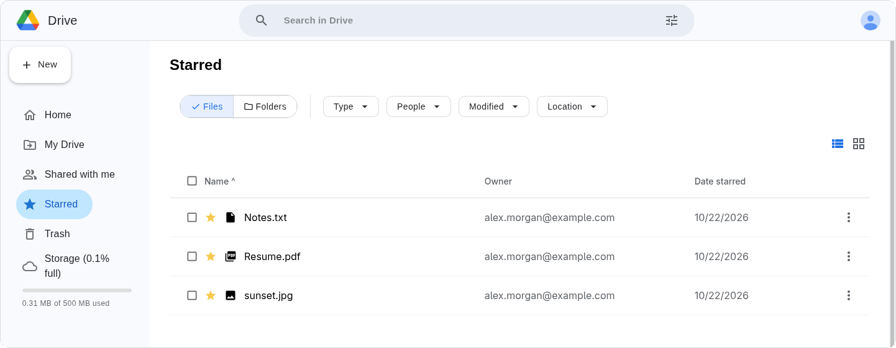
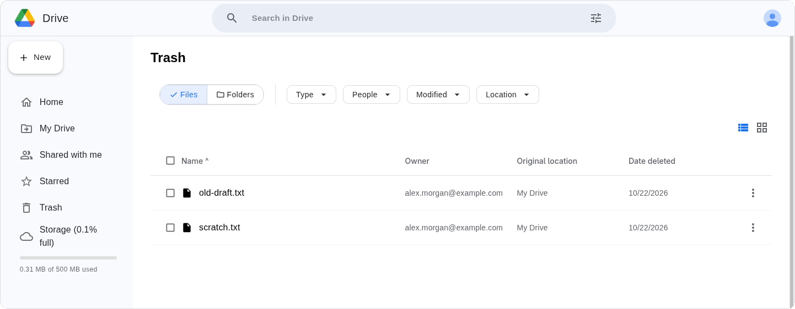

<div align="center">



<br>


**Upload files, organise them in folders, share them with other people and bring them back from the trash. All on a drive you host yourself.**

</div>

<br>

<div align="center">




<br>
<sub>Screenshots use demo accounts and made-up files.</sub>
</div>

## ✨ What it does

- **Files:** upload up to 100 MB each (stored in MongoDB GridFS), download, rename, copy, move, star, and add a description.
- **Folders:** nested folders with breadcrumbs, and zip download for a whole folder.
- **Sharing:** share a file or folder with someone by email, as read or write, and change or remove access later. Everything shared with you shows up under **Shared with me**.
- **Trash:** delete, restore, or delete permanently.
- **Search:** find files and folders, filtered by type, date and owner.
- **Batch actions:** select several items and trash, star, move, copy, share or zip them at once.
- **Accounts:** email and password sign-up, optional Google sign-in, and a forgot-password email. Sessions last 1 hour, or 30 days with "Remember me".
- **Storage bar:** each user gets a 500 MB quota that updates as they upload.

## 🚀 Run it

You need **Node 18+** and a **MongoDB** server. Any MongoDB works, local or Atlas. The quickest local one:

```bash
docker run -d -p 27017:27017 mongo:7        # or: podman run -d -p 27017:27017 mongo:7
```

**Backend** (port 5000):

```bash
cd backend
cp .env.example .env        # set MONGODB_URI and SESSION_SECRET
npm install
npm run dev
```

**Frontend** (port 5173):

```bash
cd frontend/3askar
cp .env.example .env
npm install
npm run dev
```

Open **http://localhost:5173** (use `localhost`, not `127.0.0.1`), create an account, and you're in.

Google sign-in and the reset-password email are optional. They only work once `GOOGLE_CLIENT_ID` / `GOOGLE_CLIENT_SECRET` and `EMAIL_USER` / `EMAIL_PASS` are set in `backend/.env`. Every variable is listed in [`backend/.env.example`](backend/.env.example).

## 🧱 How it's built

| Layer | Tech |
|---|---|
| **Frontend** | React 19, Vite 7, Material UI 7, React Router 7, axios |
| **Backend** | Node, Express 5, Mongoose 8, Passport, cookie-session, multer, archiver, nodemailer |
| **Data** | MongoDB for users, files and folders, and GridFS for the file bytes |

```
.
├── backend/
│   ├── server.js          # app setup, CORS, sessions, routes
│   ├── routes/            # auth, user, files, folders, batch
│   ├── models/            # User, File, Folder
│   └── utils/             # storage quota, email, orphan-file scripts
└── frontend/3askar/
    └── src/
        ├── pages/         # Login, Shared, Starred, Bin, Search, password reset
        ├── components/    # Homepage, sidebar, navbar, dialogs, menus
        ├── context/       # file state and auth
        └── api/, services/  # axios clients for each backend route group
```

Orphaned GridFS data can be checked and removed with `npm run orphan:check` and `npm run orphan:fix` in `backend/`.

<br>

<div align="center">

**Team:** Hashem Awad · Ameera Albahrani · Ahmad Faleh

<sub>A course project for CMPS 278, Web Programming &amp; Design. The interface is modelled on Google Drive and is not affiliated with Google.<br>Forked from <a href="https://github.com/3askarrr/3askar---CMPS-278-Project">3askarrr/3askar---CMPS-278-Project</a></sub>

</div>
